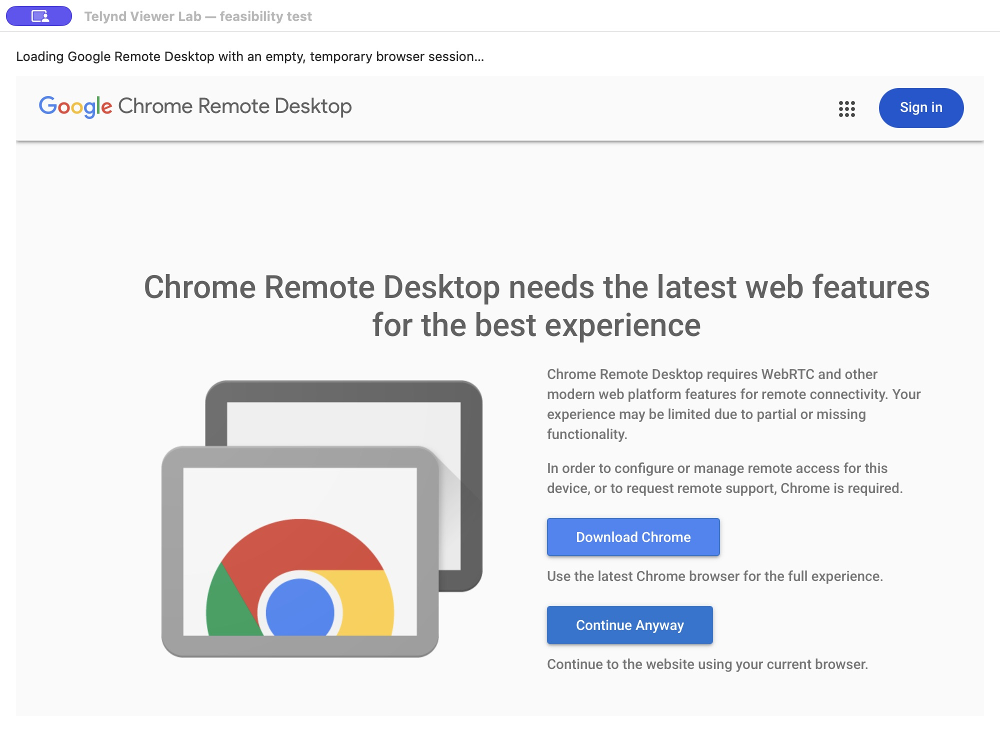

# Session viewer feasibility — 24 October 2026

Connect now requests a separate Chrome application-mode window with the saved
computer link and Chrome profile. **Open in Chrome tab** is the explicit fallback.
Both routes retain the same account and URL validation. The connection runs in
Chrome; the remote screen is not embedded inside Telynd.

## Embedded WebKit probe

The disposable [probe](../experiments/embedded-viewer/Probe.swift) uses a fresh
non-persistent WKWebView without Chrome cookies, user-agent overrides or any
credential access. It loads only Google's public Remote Desktop page and stops
navigation to Google Accounts before requesting credentials. It is excluded
from the production app.

Observed on this Mac:

1. Google redirected the WebKit view to its unsupported-browser page, with a
   warning about remote connectivity features.
2. Selecting the site's compatibility continuation led towards Google sign-in.
3. The probe deliberately cancelled that navigation and recorded the external
   authentication boundary. No credentials were entered and no authenticated
   embedded desktop session was established.

This is evidence against shipping a simple wrapper as a dependable viewer. It
does not prove that every WebKit session is impossible, or that Google rejected
an attempted OAuth login: the probe stopped before sign-in.

[Google's current OAuth policy](https://developers.google.com/identity/protocols/oauth2/policies#secure-browsers)
prohibits OAuth authorisation requests in developer-controlled embedded agents.
An external sign-in alone does not establish a supported way to pass a Google
Remote Desktop session into an independent viewer.

A [Chromium developer reply from September 2021](https://groups.google.com/a/chromium.org/g/chromium-dev/c/VqjewdmyNUg)
describes private signalling APIs and no public programmatic CRD interface.
That reply is historical evidence, not a fresh provider commitment. This
investigation did not identify a current documented public native-client SDK.
Provider-approved authentication and client access remain unresolved requirements.

## Separate Chrome window checks

The probe's optional window buttons launched Google's public device picker in
two existing Chrome profiles. Each appeared in a window without a tab strip or
address bar and displayed its own signed-in Google account. Both test windows
were closed; the pre-existing remote desktop still reported Connected.

No additional remote connection was started, so the active session was not
interrupted. The direct-host URL and alternate-tab argument paths are covered
by the Swift launch-policy tests, including refusal of unavailable or changed
profiles. This window check does not establish audio, clipboard, keyboard
capture, PIN entry or reconnection behaviour in a newly launched host session.
Google also documents its own [separate app-window experience](https://docs.cloud.google.com/architecture/chrome-desktop-remote-windows-compute-engine#install_the_remote_desktop_chrome_app).

## Decision and next acceptance work

Use Chrome's dedicated window now. Keep browser-tab fallback and the current
recovery path. Do not ship an embedded Google sign-in, copy browser cookies or
use undocumented credential-transfer workarounds.

A future integrated viewer needs a supported connection engine and account
authentication path first. Then validate two accounts, host identity, keyboard
shortcuts, clipboard consent, audio, full-screen behaviour, reconnects and
separation between sessions before release. An alternative remoting engine
would also require its own host setup and security design.

The temporary lab apps were quit, unregistered and moved to recoverable Trash.
Only the canonical Telynd app remains active. All 78 Swift tests passed locally, including rejection of stale account/link
actions and locked settings in both launch modes.
