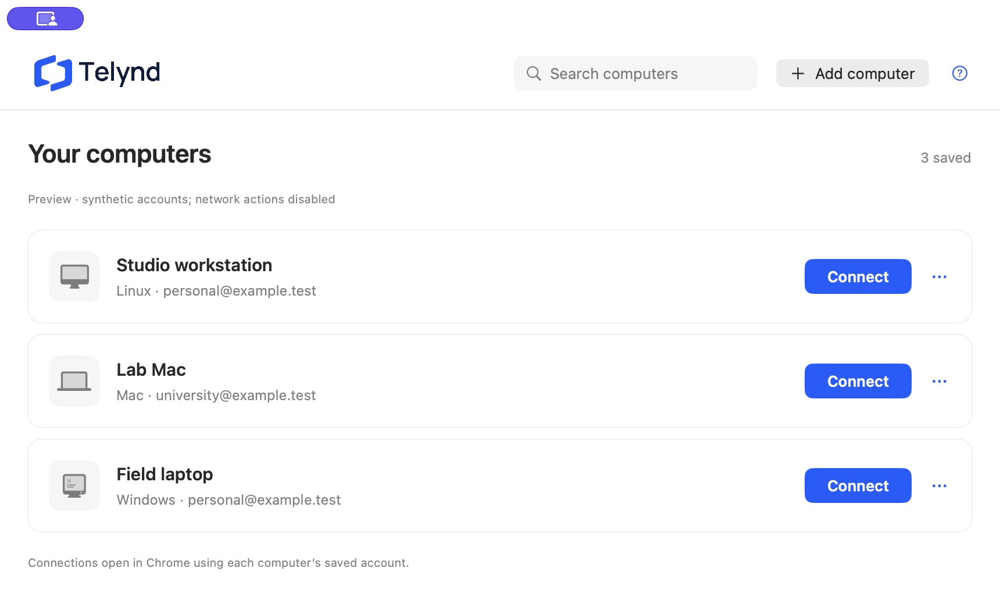
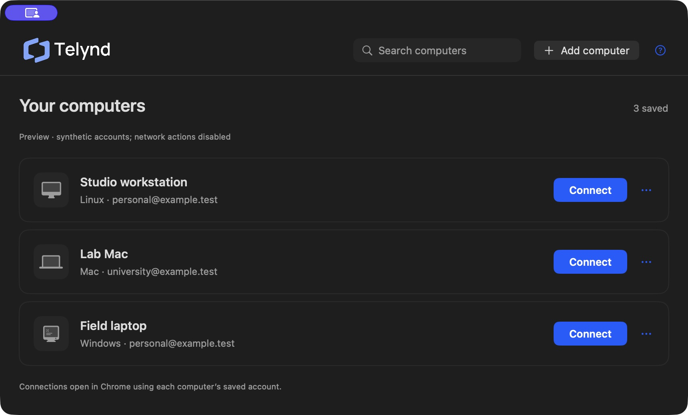
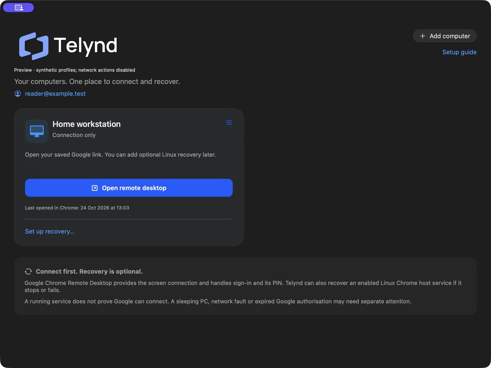

# Onboarding validation record

## Computer rows and remembered accounts, 24 October 2026

Source `9a61dbd916935c47e7643365cfea7b945682a8cb` replaces dashboard cards
with compact computer rows, a toolbar search and proportionate Connect buttons.
Each row shows its saved browser account. Editing, details and optional recovery
are available from its options menu. The editor and guide scroll their content
while keeping their actions visible. There is no global account selector.

Each computer stores a Chrome profile directory and email label. New computers
use the sole available profile automatically; several profiles require a choice
once during setup. Missing directories or changed email labels refuse launch
instead of selecting another profile, even one carrying the same email. Account
or destination changes clear previous connection-launch/confirmation evidence.
The account label comes from local Chrome metadata and does not establish the
Google identity active in a web tab. The URL reader is unchanged and cannot
infer that identity.

The one-time migration copies the previous global association onto existing
computers and setup drafts, preserving SSH settings, IDs, URLs and prior
connection evidence. A persisted migration marker prevents later drafts from
inheriting the obsolete preference. Preferences advance to schema 2, so older
builds refuse them instead of ignoring per-computer associations. A failed
migration locks writes and reports the error.

Verification: 48 Swift tests passed, including nine new tests for per-computer
launch arguments, missing/changed/ambiguous profiles, private persistence,
account-change evidence invalidation, one-time migration and refusal of unsafe
legacy data. The capture request tests also reject a result after its draft's
account changes. A release build and its ad-hoc signature passed locally.

Native synthetic checks covered two profile associations across multiple
computers, repairing an unavailable account without changing other computers,
adding a computer, searching by account, a simulated Connect, Back/close/reopen
of setup with its account and link intact, light/dark appearance, and scrolling
an editor with both manual-link and recovery sections expanded. Fixtures did
not contact Chrome or a host. The final screenshots below contain only
synthetic computers and accounts.

The user's development app was replaced in place after a private settings
backup. Read-back confirmed that migration added only each computer's previous
account association; connection and SSH fields and previous timestamps were
preserved, and settings retained owner-only permissions. Its read-only host
check reported SSH verified, Google service active and recovery timer active.
No host settings or services were changed. Two different real Google account
sessions were not exercised; account-routing arguments and UI persistence were
verified with controlled profiles. The earlier real Chrome capture/connection
evidence below remains a separate observation.

## Capture and setup-resume review corrections, 24 October 2026

Source `adcb6f954eb5d1ae4c48256bae1310c46a83f5e9` corrects two reproduced
issues from the compact-dashboard review. A capture completion now belongs to
its original editor request and draft. Manual typing/pasting, choosing another
computer, changed draft data or closing the editor invalidates the request, so
a delayed result cannot replace newer input or publish an obsolete error.
The setup guide saves its draft from the canonical saved computer, including
cleared connection evidence when its destination changes.

Verification: 39 Swift tests passed, including six new regression tests. The
app-store tests use private temporary settings with the existing fixture gates;
the test initializer is excluded from release builds. Native replays used an
isolated debug copy with a synthetic reader delayed by 20 seconds, without
Chrome or host access. Entering a different manual destination during capture
preserved that destination through completion and Save. An unchanged draft
accepted its own delayed capture and enabled Save. The legacy setup journey
also retained its corrected connection link after Save, Back, closing setup and
reopening it, with Save and continue enabled. These controlled replays test
request ownership and persistence; the real Chrome permission/capture evidence
is recorded separately below.

## Compact dashboard and Chrome-tab capture, 24 October 2026

Source `61935f19e167e010008f7208c216dee209e0431b` was built locally in release
configuration on macOS 26.4.1 / ARM64 and its ad-hoc signature verified. The
dashboard now keeps diagnostics/history under **Details & recovery**. Individual
Google session links enable **Connect**; legacy device-picker entries retain
their saved settings and offer **Set connection link**. New entries require an
individual connection link before saving.

An isolated debug fixture exercised compact cards, expansion of diagnostics,
legacy-link editing, refusal of an unsafe domain, acceptance of a valid direct
link and the setup guide's save/launch progression. No fixture contacted a
host. On the actual development app, the existing computer's individual link
was saved, prior launch/connection-confirmation timestamps were cleared and
SSH target/key settings were preserved. **Connect** opened the intended Google
session page directly; Google's UI separately reported **Connected**.

The **Use open computer** action was then tested with a temporary unsaved draft.
The user clicked the action and approved macOS Automation access to Chrome.
The app captured the intended open computer's address and enabled Save without
copying or typing a link. Reading Google's device-picker page instead produced
the expected refusal and preserved the prior draft link. The temporary draft
was cancelled, leaving no extra saved computer. A subsequent live readiness
check reported Google active and recovery enabled with its timer active.

The browser reader sends a fixed Apple event for the front active tab's URL
only when requested. It does not enumerate tabs, read page content or retrieve
a Google inventory. The captured address is untrusted input and must pass the
same exact-host HTTPS session-link validation before filling a draft; saving
remains explicit. macOS grants app Automation access, which is broader than
the reader's specific URL request. The usage explanation and trusted signing
entitlement are recorded in the source and release guide.

Verification: 33 Swift tests, nine adversarial release-validation tests, local
release build/signature checks and the native UI observations above. Real
permission denial, Chrome not running, other macOS versions and Developer ID
distribution were not exercised in this live capture pilot. Validation and
error guidance cover these cases in code; they remain separate from observed
success on this configuration. No host identifiers, account labels, connection
URLs or remote screen content are included here.

## First registered Linux-host recovery, 24 October 2026

This pilot recovered an already-failed Google Chrome Remote Desktop service on
a personal Linux host. It is evidence for the tested configuration and initial
reconnection, not completion of the full acceptance criteria in #13.

| Component | Recorded configuration |
| --- | --- |
| Telynd client | Locally built development app, version 0.2.0/build 2, source `8ed2fea62a86a34083d9221602aaea845ceb3144` |
| Controlling computer | macOS 26.4.1, ARM64 |
| Remote host | Ubuntu 24.04.5 LTS, Linux 6.8.0-147-generic, x86_64 |
| Chrome Remote Desktop Linux package | 144.0.7559.29 |
| Recovery component source | Bundled `scripts/setup-remote.sh` at the same source revision; SHA-256 `fd5d1604881b122c1e7a4ffdf488f2d828dc44ef5fcd33236f1577ac8d4a22dc` |

Before installation, strict non-interactive SSH access worked, Google's service
was loaded and enabled but failed, and Telynd recovery was missing. No deliberate
outage was introduced. Existing SSH authorisation was reused; first-time key
creation/authorisation was not exercised in this pilot.

The fresh app's onboarding selected the intended existing Chrome profile, saved
a Linux computer, opened Google's device picker and continued to optional
recovery without claiming a successful session. Telynd's readiness check
verified SSH. Its **Install recovery** action explained the helpers, narrow
password-free permissions and two-minute timer. The user approved installation
and entered the remote administrator password in Terminal. The installer receipt
reported installed, and a subsequent app/SSH check verified the root-side
manifest, enabled/active timer and enabled/active Google service without an
account-password prompt.

The recovery service completed successfully (exit status 0) at **16:35:18 BST**;
Google's service entered its active state at the same timestamp. Google then
provided a connectable device entry and its session UI reported **Connected**.
The user subsequently confirmed the result. Service activation and Google
connection were observed separately; no credentials or session contents are
included in this record.

A later timer execution at **16:37:34 BST** also returned success while Google's
active-enter timestamp remained **16:35:18 BST**. This observes an active service
being left running across that tick; it does not establish every concurrent or
active-session preservation case. The checked final state was Google enabled
and active, with Telynd's timer active. The Mac app remained open.

### Controlled interruption with the Mac client closed

The user separately approved a brief interruption of the same host. Strict SSH
access, the verified recovery installation and its enabled/active timer were
checked first. Google's service was active and enabled, with native systemd
`Restart=no`. Telynd was quit and process absence was verified before signalling
the Google service.

At **16:48:02 BST**, the test sent SIGTERM to the verified per-account Google
service main process using a Linux pidfd (a stable process handle that avoids
signalling a reused PID). This was a process-termination test, not a
`systemctl stop` or change to Google's enablement/configuration. The unit was
first observed inactive **2.555 seconds** after the signal.

The first observation of the service active again was **40.825 seconds** after
the signal, measured with the remote monotonic clock and 0.5-second polling.
The recovery timer's trigger and Google's active-enter timestamp both reported
**16:48:42 BST**. The installed helper, rather than Google's native restart
policy or the closed Mac app, provided automatic recovery. The fixed recovery
helper was available as the approved fallback but was not needed. No additional
account-password prompt was encountered.

Final host-side verification reported Google enabled/active, the installation
verified and the recovery timer enabled/active. Google's device list was
refreshed and a new connection reported **Connected** in the session UI. Telynd
was still absent from the Mac's process list through that reconnection check;
it was reopened only afterwards. Browser interaction was not an instrumented
measurement of Google's earliest availability or end-to-end reconnect latency.
The 40.825-second result is the observed service-recovery time for this timer
phase, not a promised recovery duration.

### Intentional disablement, including an incomplete first attempt

At **17:03:20 BST** on the same day, a separately approved test disabled and
stopped Google's service. The installed recovery helper refused to start it
with exit status 3, reporting that it was not enabled. A host-local transient
timer was armed beforehand to restore Google's original enabled/running state
after four minutes if the test lost control.

The test harness then failed while interpreting systemd's human-readable
`LastTriggerUSecMonotonic` duration as an integer. Its cleanup restored Google
to enabled/active at **17:04:28 BST**. A second harness error reported the
safeguard cleanup as failed because its never-started transient service was
absent. Independent SSH read-back subsequently verified Google enabled/active,
the installed recovery manifest verified, Telynd's timer enabled/active and
both transient safeguard units absent/inactive. This attempt establishes the
explicit helper refusal, but is not recorded as a passing end-to-end
intentional-disablement test.

The private harness was corrected to query typed D-Bus microsecond values and
accept an absent transient service during cleanup. Read-only queries against
the host and local regression checks passed before a second live run.

The corrected run disabled and stopped Google at **17:07:27 BST**. The direct
helper again refused with exit status 3. Telynd's real timer subsequently
triggered at **17:08:39 BST**; its recovery service also exited with status 3,
and Google remained inactive and disabled. The completed timer refusal was
observed **72.603 seconds** after the direct helper check. This measures the
wait for that timer phase, not a recovery duration.

The test reported success and restored Google to enabled/active at
**17:08:40 BST**, then cancelled its independent restoration safeguard. The
test exited 0. Subsequent strict SSH verification confirmed the recovery
installation verified, Google enabled/active, Telynd's timer enabled/active and
both transient safeguard units absent/inactive. Google screen reconnection was
checked separately after the lifecycle tests below.

### Recovery lifecycle through the Mac app

The app's **Disable timer** action opened its normal confirmation and Terminal
flow. The user completed the remote administrator prompt. The receipt reported
`disabled`; independent SSH checks verified the Telynd installation remained
valid and its timer was inactive/disabled. Google's service stayed
enabled/active, with the same monotonic active-enter timestamp as before the
action. The app's refreshed readiness report also showed the inactive timer.

The app's **Uninstall recovery** action used the same confirmation/Terminal
flow and reported `uninstalled`. A new strict SSH connection verified both
helpers, both systemd unit files, the sudoers entry and the installation ledger
were absent. The recovery units were not loaded. Google remained
enabled/active with its original active-enter timestamp; SSH continued to work.

The app's **Install recovery** action then restored the same source version.
Its receipt reported `installed`; the root-side manifest verified, and the
timer was enabled/active. Both fixed helpers ran through `sudo -n` without an
account-password prompt. The recovery helper reported the Google service was
already running and needed no restart. Google's active-enter timestamp stayed
unchanged across all three lifecycle actions. The refreshed app dashboard
reported recovery enabled. This tests removal/reinstallation of the same
version, not an upgrade to a different release.

Finally, Telynd opened Google's device picker in the intended Chrome profile.
A new connection to the same host completed and Google's session UI reported
**Connected**. This is a separate screen-connection observation after the
disablement and lifecycle tests; no end-to-end reconnection latency is claimed.

**Remaining evidence:** a different-version update remains untested. Existing
SSH authorisation was reused; first-time key authorisation remains untested. These were guided
developer-build pilots, not an independent novice study or a signed
browser-download test. Mac and Windows Google-host pilots remain #18; signed
Mac client distribution remains #11.

## Cross-platform recovery implementation, 24 October 2026

The #14 work extends the existing Mac client with platform selection and Mac/
Windows host-local developer kits. It does not establish signed standalone host
installation, novice usability or a working session on registered Google hosts.
The earlier Linux/onboarding evidence below remains scoped to that implementation.

| Environment | Evidence | Practical limit |
| --- | --- | --- |
| Local macOS 26.4.1 / ARM64 | Swift migration/report tests; Mac file/command fixtures; native SwiftUI Windows kit/report-import journey | Synthetic identities and reports; no personal host mutations |
| CI macOS runner, reported 26.6.2 / 25G83 / ARM64 | Real launchd bootstrap, idempotent start, active preservation, deliberate disablement, persistent Telynd disable and verified removal against an ad-hoc signed synthetic host | Fixture replaces Google's identity/root-ownership provider; no Google registration or privacy approval |
| CI Windows Server 2025 / 10.0.26100 / AMD64 | Real SCM service, native policy/security-descriptor queries, policy apply/read-back, retry, drift refusal, ACL refusal, restoration and bounded crash recovery | Synthetic service; Only the synthetic root and signature query are substituted; production host validation runs against real file, registry and service ACLs; no Windows 11 Google-host installation |
| Windows PowerShell 5.1 and PowerShell 7 on that runner | Same native service lifecycle under both runtimes | Does not establish every desktop Windows version or enterprise policy |
| Ubuntu/systemd CI | Existing real Linux install/authorisation/ancestry/removal regression coverage | Synthetic Chrome service; real Google pilot remains #13 |

The first complete passing cross-platform PR run is
[Checks 40100653327](https://github.com/exponentialR/telynd/actions/runs/40100653327)
at source `ccefab4f944bc9337af1021f5c58f423cd674f1f`. Subsequent commits refine
UI copy, bounded regular-file report reads, native-test output isolation and
additional service-security coverage; inspect the PR's current checks before merging.

Current local coverage: 30 Swift tests and 42 discovered Python tests (41 run on
macOS, one Linux-only flock test skipped; Linux skips ten Mac-only tests).
Windows and native launchd tests are separate disposable CI scripts. File
fixtures replace fixed command/path providers only in copies; product scripts
have no testing bypass parameter or configurable service target.

Native UI inspection used a debug app under a temporary directory, with three
synthetic desktops. Mac and Windows recovery sheets show local-kit instructions
without SSH setup. Importing the Windows fixture displays crash-only scope,
host timestamp, unknown live identity and Google availability; no Linux timer or
SSH success is inferred. Layout was visually inspected. These checks do not
constitute a novice study or full VoiceOver walkthrough. The normal installed
app was not restored and the user's backed-up desktops/settings remain separate.

Self-review corrected persistent Mac disablement, foreign launch-label refusal,
fail-closed enablement vocabulary across launchctl versions, unknown service
states, safe parent ACL interpretation, PowerShell optional-string marshalling
and atomic ledger replacement. Completed Mac removal no longer fails merely
because Google's installation is unhealthy. Read-only inspection of an existing
Google Mac bundle refused a damaged sealed subcomponent; it was not repaired or
used for a live recovery test. This is implementer self-review, not an independent
security audit.

### Critical-review follow-up

The follow-up fixes preserve Windows hosts intentionally stopped by Google:
Manual and Disabled modes remain stopped, and setup/manual recovery require
Automatic mode. The Windows fixture now executes the production host validator
with only its synthetic installation root/signature provider substituted. It
exercises rejected launch paths/accounts, invalid signatures/publishers, writable
executables, registry keys and service DACLs, then verifies safe restoration.
This exposed and corrected a real Windows PowerShell 5.1 registry-provider lookup
failure that the earlier whole-validator substitution had hidden.

The Mac kit uses a native descriptor lock that releases after process death;
fixtures prove concurrent refusal, partial readiness while busy and recovery
after SIGKILL. Legacy directory locks remain fail-closed with partial readiness.
Unsupported native locking is refused before helper/agent installation. Review
also found that malformed retry state could block ticks while reporting ready:
checks now report partial readiness, and state updates use an atomic replacement.
Local follow-up validation passed 30 Swift tests and 42 discovered Python tests
(41 run on macOS, one Linux-only skip). Native Windows and launchd verification
remain separate disposable CI checks; consult the PR's final source checks.

### Real-host evidence still required

Keep #16/#17 open for real installed Google hosts and their signing/distribution
criteria, #18 for Mac/Windows operational validation, #13 for the Linux pilot
and #11 for signed Mac client browser-download testing. Before a disruptive
test, approve the specific non-critical host and establish independent access.
Record the client/helper revisions, OS/architecture, Google version, actual
permissions/setup prompts, failure trigger, start attempts and separately
confirmed Google reconnection. Repeat with the controlling Mac closed; verify
intentional disablement, active-session preservation, updates and removal.
Restore the agreed host state. Publish only sanitised outcomes and failures.

Windows orderly-stop recovery is explicitly excluded from automatic crash
recovery. Mac recovery before login, automatic privacy approval, Intel/earlier
Mac runtime support, Windows desktop hardware coverage, and ordinary standalone
signed kit installation are unverified. Imported snapshots do not authenticate
the host or current state and cannot authorise remote mutations.

---

The following sections record the earlier fixture-based onboarding verification;
the registered Linux-host pilot above is separate.

Validation date: 24 October 2026. This is engineering verification by the
implementer, including self-review. It is not a study of independent novice
users and does not establish usability timings or a live Google connection.

## Automated checks

Local security-update results: 20 Swift tests passed; Python discovers 32 tests
(31 passed and one flock test skipped on macOS). Linux runs all 32 and the
systemd integration.

- Swift core tests cover connection-only and legacy models, strict supported
  links, corrupt/future settings, duplicate identities, private atomic saves,
  migration precedence, resumable guide/draft data, ambiguous/missing profiles,
  stale evidence, SSH failure categories and bounded process execution.
  Incomplete output and failed SSH transport cannot establish readiness.
- Python fixtures cover unsupported OS/systemd, missing/stopped services,
  read-only checks, active/failed/disabled/transitioning services, failed starts,
  helper argument rejection, Linux flock concurrency, separate authorisation,
  missing/existing keys, explicit passphrase prompting, failed upload and
  distinct authentication/verification receipts. These use command stubs, not
  real login passwords. macOS skips flock concurrency; Linux executes it.
- `tests/linux-integration.sh` runs only in an explicitly disposable systemd
  environment. It creates a synthetic account and sleep-based Chrome unit,
  tests rejection of foreign files, injected interruption between copies,
  retry, root read-back, disabled-host preservation, real sudoers argument
  restrictions, denial of unrelated sudo commands, idempotent start, permission
  drift, a missing owned component, disable and repeated uninstall. The Chrome
  unit and its PID survive removal. Its temporary broad administrator rule is
  test-fixture infrastructure and is removed before checking the product's
  narrow permissions; production installation never creates that rule.
- SSH tests use real offline `ssh -G` resolution against deliberately unsafe
  defaults. Both Swift readiness and shell actions override host trust,
  forwarding, local commands and multiplexing. Authorisation fixtures verify
  first-contact prompting and a subsequent strict fresh connection.
  Swift and shell policy tests also pass paths containing spaces, quotes,
  backslashes, tabs and comment characters through the real offline SSH parser,
  checking that the selected identity is preserved.
- Authorisation tests use real local key validation and offline OpenSSH option
  parsing with filenames containing quotes, backslashes, spaces, command
  substitutions and backticks. Key comments remain stdin data, and malformed,
  multiple or oversized keys fail before SSH. The Keychain/transport adapters
  do not contact real accounts. Mac CI runs these cases too.
  Mismatched pairs and invalid private keys stop before agent or SSH calls.
  Encrypted Ed25519, RSA and ECDSA fixtures exercise OpenSSH's standard passphrase
  reader through a fixture askpass program. An additional configured identity
  remains visible in real SSH option resolution, and success wording reports
  account access with that limitation.
- `tests/linux-authorisation.sh` uses a disposable Linux account and actual
  shell execution, key tools, file permissions and locks. It covers hostile
  comments, existing restricted entries, missing final newlines, concurrent
  retries and symlink/hardlink refusal. It also runs the actual Mac wrapper's
  fixed remote command through a local transport adapter into that account.
  This verifies the command/data boundary without a live SSH server or password.
  It passed locally in a disposable Debian container with networking disabled
  and no host-folder mounts; CI repeats it on Ubuntu.
  Fault cases cover a missing lookup tool, non-zero lookup status (including
  misleading stdout), empty/unexpected output and failed final-byte reads.
  A real unreadable-file case verifies restricted contents and permissions are
  unchanged. Test-only copies substitute the command path for adapters; the
  production installer retains its fixed system path and has no fault flags.
- Deterministic host-check state tests deliver superseded completions while a
  newer request is busy and after it has completed. They also cover returning
  to the original target, discarding the current request, retry and independent
  desktops. These exercise the state component used by AppStore without live
  SSH or timing-dependent sleeps.
- Release tests reject off-main commits, moved tag objects and insufficient
  protection. Archive tests reject traversal, links, duplicate or extra files,
  resource changes, preview metadata and excessive size. They use synthetic
  binaries; separate Mac CI validates the real ad-hoc app archive and signature.
- The real directory guards passed in a disposable Linux container without
  host mounts or networking, covering writable/non-root-owned ancestors,
  symlinks, missing directories and invalid path forms. Systemd integration
  adds actual installer, readiness, helper and uninstaller refusal when
  `/usr/local` becomes writable.

The disposable Debian 13.4 ARM64 VM passed that integration script, including an
interrupted upgrade with mixed old/new components and refusal of content drift, and all Linux
recovery decision tests including concurrency, and installation/readiness
read-back. It had no host-folder mounts. This validates real systemd/sudoers
behaviour against the synthetic service, not Google's registered host binary.
GitHub Checks repeats the integration on an Ubuntu runner. The first CI run
found a test-fixture assumption that `/usr/local/libexec` already existed; the
fixture now prepares that directory before placing its synthetic foreign file.

## Native Mac journey

Local environment: macOS 26.4.1 (25E253), ARM64, Swift 6.3.3. A debug-only app
used an isolated Application Support fixture with synthetic `example.test`
accounts. Chrome launches were simulated and SSH actions were blocked. Release
builds ignore the preview configuration and use the normal private settings.

Observed through the native interface:

| Journey | Outcome |
| --- | --- |
| Empty settings | Welcome guide opens; SSH is not requested |
| Multiple profiles | Existing profiles listed; explicit selection enables Continue |
| Signed-out profile | Label directs user to Chrome sign-in; refresh offered |
| Computer without SSH | Name + Google picker saved as connection-only |
| Invalid Google link | Save remains disabled |
| Unconfigured Google host | Setup guidance and Google's picker are available |
| Close at connection step, quit/relaunch | Saved computer/profile and connection step resume |
| Simulated Chrome launch | Launch recorded; no connected-session claim |
| Defer recovery | Guide finishes and connection-only card remains usable |
| Relaunch after completion | No forced first-run sheet |
| Existing installed app | Both saved desktops unchanged; requested Chrome profile migrated; no forced guide |
| Recovery settings | SSH details and key path separate from connection fields; unknown states explicit |
| Keyboard | Text-field Tab navigation and visible focus inspected; Return/Escape shortcuts provided |
| Accessibility | Native accessibility tree exposes descriptive field/button names, including named Edit controls |
| Light/dark | Native light welcome/card and dark card/editor inspected for clipping and readable text |

To repeat the isolated UI journey, create a private fixture directory with a
`chrome-state.json` containing only synthetic `profile.info_cache` metadata,
then build using `TELYND_BUILD_CONFIGURATION=debug` and
`TELYND_FIXTURE_DIRECTORY=/absolute/fixture/path`. Set
`TELYND_PREVIEW_APPEARANCE=light` or `dark` to inspect an app-only appearance.
Use a separate output app and quit it before replacing it. Empty fixture
settings start the guide; completed fixtures exercise relaunch. Do not publish
real Chrome profile data or screenshots containing personal host details.

## Review corrections

The final authorisation pass requires a successful explicit presence/absence
lookup before appending and checks the final-byte read independently. Tool
failures cannot add an unrestricted duplicate of a restricted entry. The Mac
wrapper also derives and compares the selected private key's public identity
before agent or network activity. Final connection verification is described
as account access using the user's SSH configuration; additional identities
can participate. It is separate from the local key-pair comparison.

The dependency-level review found that the installed `ssh-copy-id` evaluated
key filenames internally. A harmless isolated marker reproduced substitution
before any network connection. Telynd now removes that dependency from
authorisation: validated public-key text travels only on stdin to a fixed
Linux installer command. Filenames are never inserted into remote commands,
and the installer discards comments without evaluating them. It serialises
updates, preserves existing restrictions and refuses unsafe destination types.
The earlier stub-only setup tests could not establish this boundary; the new
tests exercise real parsing and the real installer under a disposable account.

A further pre-merge pass found unescaped `IdentityFile` configuration values
and a late-completion race after target/key edits. Both Swift and shell policy
now quote and escape the path for SSH configuration syntax. AppStore owns a
request-aware host-check state component: saved target/key edits invalidate the
old request, and only the current request may publish or clear its observation.
Matching target/key strings alone cannot accept an older result after an
A-to-B-to-A edit.

The security review identified four additional issues: writable directory
ancestors could permit replacement of a root-executed helper; initial
`ssh-copy-id` could inherit disabled host checks; background SSH could inherit
agent forwarding or reuse an existing connection; and arbitrary tagged release
scripts could run in the signing environment. The fixes validate full Linux
directory ancestry, impose explicit SSH policy, pin reviewed main-history
source under protection checks and isolate builds from credentialed signing.
The release job treats artifacts as data and executes only trusted workflow-main
validation/signing scripts. GitHub protection configuration and Apple credentials
remain prerequisites; the credentialed release path has not been executed.

Self-review tightened SSH time/output bounds and rejects partial success
protocols, clears observations when the target or key changes, blocks recovery
from unsaved or stale details, and associates Terminal receipts with the exact
saved target/key. A prepared action cannot inherit an old successful receipt.
Root helpers use a fixed system PATH. Recovery requires explicit enabled or
enabled-runtime state; systemd static/indirect/linked states are left alone too. The installer serialises setup operations, verifies surviving recorded files before retry and refuses
unknown files or content drift. Application replacement validates a fresh whole
bundle before swapping it, preventing obsolete resources and Finder metadata
from surviving an update. Settings writes also reapply owner-only permissions
when replacing an older file with broader metadata. Unfinished guide drafts are private and distinct
from saved valid desktops.

## Concrete remaining limits

Missing Chrome and changed/removed Chrome profiles have automated launch-plan
and profile fixtures; Chrome was not uninstalled from the user's Mac to test
that guard. Protected-key unlocking, wrong real passwords and first host trust
remain standard interactive SSH/Keychain operations; fixtures check failure
handling, but no personal account was modified during this validation. Native
accessibility labels were inspected; a complete spoken VoiceOver walkthrough
with a screen-reader user remains useful follow-up validation. Full button Tab
navigation depends on the user's macOS Keyboard Navigation setting.

No Mac Intel runtime or macOS 13–25 runtime was tested. No Google PIN,
sign-in state or active screen session was inspected by the test fixture.
A real registered Google-host end-to-end pilot remains separate from the
controlled systemd installation evidence. No private Alienware/QUB host was
changed. No signed-release/quarantined-download test was performed: Apple
credentials are absent, as recorded in [release preparation](releasing.md).
